<div align="center">


# CCTVMAKOTA

**Informasi kepadatan lalu lintas & navigasi anti-macet Kota Malang — YOLO11 + CCTV ATCS publik**

CCTVMAKOTA membaca **5 kamera CCTV ATCS** di sekitar Universitas Brawijaya, menghitung kendaraan per jenis di jalur yang dipantau (**ROI**), menentukan status **LANCAR / PADAT / MACET**, lalu menyarankan **rute alternatif** dengan perhitungan **V/C** dan rumus **BPR**. Semua disajikan dalam satu dashboard web responsif: halaman publik tanpa login, plus panel admin tersembunyi untuk mengatur ROI, ambang, dan rute.


[Mulai Cepat](#mulai-cepat) · [Fitur](#fitur) · [Screenshot](#screenshot) · [Struktur Proyek](#struktur-proyek) · [Referensi API](#referensi-api)

</div>

---

## Daftar Isi

1. [Fitur](#fitur)
2. [Mulai Cepat](#mulai-cepat)
3. [Cara Penggunaan](#cara-penggunaan)
4. [Arsitektur](#arsitektur)
5. [5 CCTV Area Brawijaya](#5-cctv-area-brawijaya)
6. [Struktur Proyek](#struktur-proyek)
7. [Instalasi](#instalasi)
8. [Konfigurasi Deteksi](#konfigurasi-deteksi)
9. [Model & Pelatihan](#model--pelatihan)
10. [Referensi API](#referensi-api)
11. [Screenshot](#screenshot)
12. [Pemecahan Masalah](#pemecahan-masalah)
13. [Keamanan & Etika](#keamanan--etika)
14. [Lisensi & Kredit](#lisensi--kredit)

---

## Fitur

- **Deteksi kendaraan YOLO11s hasil fine-tune** frame CCTV Malang — 4 kelas: mobil, motor, bus, truk. Tetap bekerja saat pagi, malam, dan hujan berkat **CLAHE otomatis**.
- **Tiling 2×3 + NMS gabungan** — frame penuh ditambah 6 potongan, sehingga kendaraan kecil/jauh tetap terdeteksi.
- **Hitung per jalur (ROI)** — hanya kendaraan di dalam poligon jalur yang dihitung; tersedia **dua arah** (`roi` dan `roi2`) untuk kamera yang memantau dua lajur.
- **Status kepadatan** per kamera: **LANCAR / PADAT / MACET**, dengan ambang `density_low`, `density_high`, dan `calibration_max_count` yang bisa diatur per lokasi.
- **Rekomendasi rute** memakai **V/C ratio** dan **rumus BPR** (`t = t0 × (1 + 0,15 × (V/C)^4)`); rute utama dialihkan hanya bila macet dan ada alternatif yang lebih cepat.
- **Peta GIS Kota Malang** dari OpenStreetMap: jaringan jalan, pin CCTV berwarna sesuai status, dan analisis kecocokan ruas jalan.
- **Navigasi anti-macet di HP** — izin lokasi, "Anda sekarang di Jl. …", peringatan berwarna, pilihan jalur, petunjuk arah, dan tombol **Buka di Google Maps**.
- **Dashboard publik satu file** (`cctvmakota-dashboard/dashboard.html`) — tab **Dashboard**, **Pantauan & Rute**, **Navigasi**, **Riwayat**; tema terang/gelap; responsif di HP, tablet, dan desktop.
- **Mode contoh tanpa server** — buka `dashboard.html?demo=1` untuk melihat seluruh tampilan dengan data simulasi.
- **Panel admin** di `#admin` — ringkasan kamera, kontrol rute, ruas jalan, lokasi & ambang (geser pin di peta), dan **editor ROI**; perubahan bisa disimpan ke config.
- **Riwayat opsional di Supabase** + unduh CSV; hasil deteksi bisa diunduh sebagai **JPG, PNG, JSON, atau CSV**.
- **Tanpa kendali lampu** — sistem ini murni *decision support*: memberi rekomendasi, bukan mengatur lampu lalu lintas.

## Mulai Cepat

Prasyarat: **Python 3.10–3.12**, **ffmpeg** di `PATH`, dan (opsional) GPU NVIDIA. Tanpa GPU tetap jalan, hanya lebih lambat.

```bash
git clone <url-repo> cctvmakota
cd cctvmakota

python -m venv .venv
# Windows (PowerShell)
.venv\Scripts\Activate.ps1
# Linux / macOS
source .venv/bin/activate

# Tanpa GPU (VPS/PC biasa): pasang PyTorch versi CPU lebih dulu
pip install torch torchvision --index-url https://download.pytorch.org/whl/cpu
pip install -r requirements.txt

# Token panel admin (wajib untuk membuka #admin)
# Windows
$env:ADMIN_TOKEN = "token-rahasia-anda"
# Linux / macOS
export ADMIN_TOKEN="token-rahasia-anda"

python -m uvicorn app:app --host 0.0.0.0 --port 8011
```

| Alamat | Isi |
|---|---|
| `http://127.0.0.1:8011/` | Dashboard publik (Dashboard · Pantauan & Rute · Navigasi · Riwayat) |
| `http://127.0.0.1:8011/#admin` | Panel admin (butuh `ADMIN_TOKEN`) |
| `http://<IP-komputer>:8011/` | Akses dari HP di Wi-Fi yang sama |

Hanya ingin melihat tampilannya? Tidak perlu server maupun model:

- `cctvmakota-dashboard/dashboard.html?demo=1` → dashboard dengan data simulasi (bisa dibuka langsung lewat `file://`).
- `cctvmakota-dashboard/dashboard.html?demo=1#admin` → panel admin mode contoh.

> **Bobot model tidak disertakan di repo.** Letakkan `best.pt` di `runs/yolo11s_malang_live/weights/` sesuai config, **atau** ubah `detect.model` menjadi nama model Ultralytics yang akan diunduh otomatis, misalnya `yolo11s.pt`. Detail di [Instalasi](#instalasi) dan [Pemecahan Masalah](#pemecahan-masalah).

## Cara Penggunaan

### Dashboard publik (`/`)

Terbuka untuk umum, tanpa login. Menu ada di header; di HP menu pindah ke bar bawah agar mudah dijangkau jempol.

| Tab | Kegunaan |
|---|---|
| **Dashboard** | Status lalu lintas, jumlah kendaraan di jalur ROI dan di seluruh frame, tingkat kepadatan + ambang padat/macet, komposisi jenis kendaraan, grafik rata-rata per jam (hari ini / kemarin / 7 hari), daftar lokasi, dan data terbaru. |
| **Pantauan & Rute** | Rekomendasi rute, peta pin CCTV berwarna status, analisis GIS ruas jalan, perbandingan rute + simulasi kepadatan, kamera terbaru dengan overlay ROI, dan tabel hasil deteksi (unduh JPG/PNG/JSON/CSV). |
| **Navigasi** | Izin lokasi atau **Coba dengan titik demo**, peringatan berwarna, peta rute A→B, simulasi **Lancar 0% / Padat 60% / Macet 95%**, pilihan jalur, petunjuk arah, dan **Buka di Google Maps**. |
| **Riwayat** | Tabel riwayat deteksi, pilih jumlah baris, muat ulang, dan unduh CSV (butuh Supabase). |

Dropdown **lokasi** di kanan atas memfilter seluruh tab ke satu kamera. Indikator **API** menunjukkan status koneksi ke server, dan tombol tema mengganti tampilan terang/gelap.

### Panel admin (`#admin`)

Panel admin **tidak ditautkan** dari navigasi publik — simpan alamatnya sebagai bookmark.

1. Buka `http://127.0.0.1:8011/#admin`.
2. Masukkan token dari environment variable `ADMIN_TOKEN`.
3. Pilih lokasi, lalu gunakan menu:

| Menu | Fungsi |
|---|---|
| **Ringkasan** | Status seluruh kamera dalam satu tampilan. |
| **Kontrol rute** | Paksa rute utama/alternatif atau kembalikan ke otomatis; atur status dan catatan koridor. |
| **Ruas jalan** | Nama jalan, kapasitas, waktu tempuh normal, dan jarak; gambar ruas di peta. |
| **Lokasi & ambang** | Geser pin kamera, atur ambang `density_low`/`density_high` dan kapasitas kalibrasi. |
| **Editor ROI** | Gambar poligon jalur di atas frame kamera, lalu simpan. |
| **Simpan ke config** | Tulis ROI, koordinat, ambang, ruas jalan, dan opsi koridor ke `config.cctvmakota.yaml`. |

Perubahan dari dashboard disimpan di `runtime_state.json` dan menimpa nilai awal di config. Berkas config asli dicadangkan sebagai `*.bak` saat disimpan.

## Arsitektur

```text
CCTV ATCS (stream HLS)
        │  ffmpeg, polling tiap 30 detik
        ▼
  1 frame JPEG
        │
        ▼
vision.detect_vehicles
  CLAHE otomatis ─► YOLO11s frame penuh + 6 tile 2×3 ─► gabung NMS
        │
        ▼
filter ROI per kamera ─► jumlah per kelas ─► status LANCAR / PADAT / MACET
        │
        ▼
atcs_routing
  V/C ratio ─► waktu tempuh BPR ─► rute utama vs alternatif
        │
        ├──► FastAPI (app.py + admin_api.py) ──► dashboard satu file
        │
        └──► Supabase `greenflow_logs` (opsional) ──► tab Riwayat
```

Polling, deteksi, dan penyimpanan berjalan di latar belakang. Dashboard mengambil data lewat HTTP polling; tidak ada MQTT dan tidak ada kendali lampu.

## 5 CCTV Area Brawijaya

| Kamera | Lokasi | Koordinat | Jalur ROI |
|---|---|---|---|
| `JlVeteranArahTimur-CCTV` | Jl. Veteran Arah Timur | -7.953, 112.614 | Jalur Utama ke Kampus |
| `JlMtHaryonoArahBarat-CCTV` | Jl. MT Haryono Arah Barat | -7.9445, 112.6065 | Jalur Belok Timur |
| `JlGajayanaArahUtaraSardo-CCTV` | Jl. Gajayana Arah Utara (Sardo) | -7.9455, 112.6035 | Jalur Sardo |
| `JlSoekarnoHattaArahSelatan-CCTV` | Jl. Soekarno Hatta Arah Selatan | -7.9423, 112.6217 | Jalur Soekarno Hatta |
| `JlSumberSariArahUtara-CCTV` | Jl. Sumber Sari Arah Utara | -7.949, 112.617 | Jalur Sumber Sari |

Semua kamera memakai mode `cctv` (stream HLS publik), sehingga tidak memerlukan perangkat keras tambahan. Daftar lengkap beserta URL dan poligon ROI ada di `config.cctvmakota.yaml`.

Contoh deteksi pada frame terpadat:

| Soekarno Hatta (42 kendaraan) | Veteran (15) | MT Haryono (11) |
|---|---|---|
| 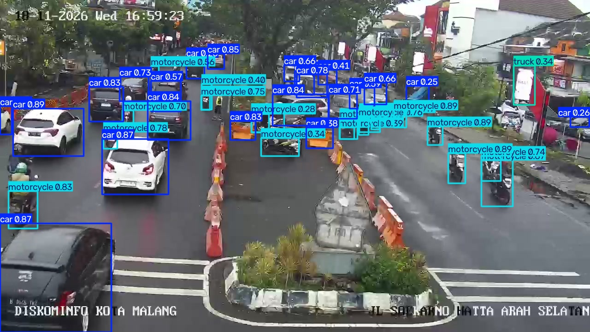 |  |  |

| Sumber Sari (11) | Gajayana / Sardo (6) |
|---|---|
| 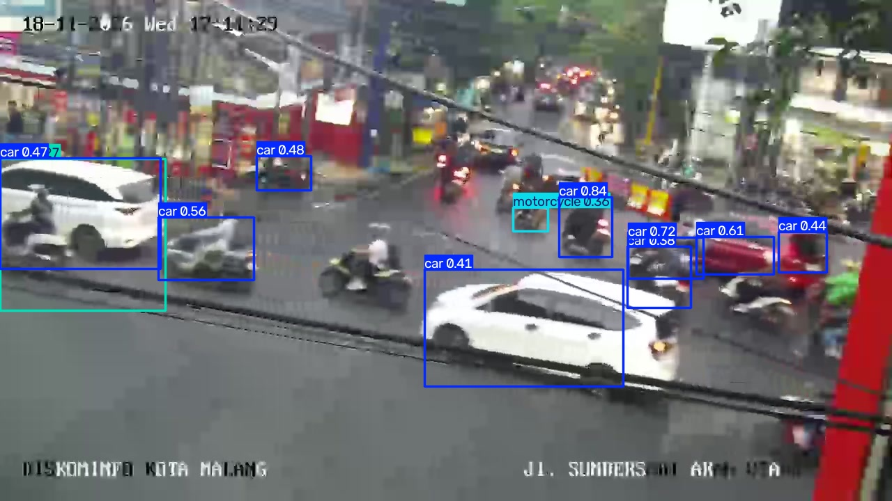 | 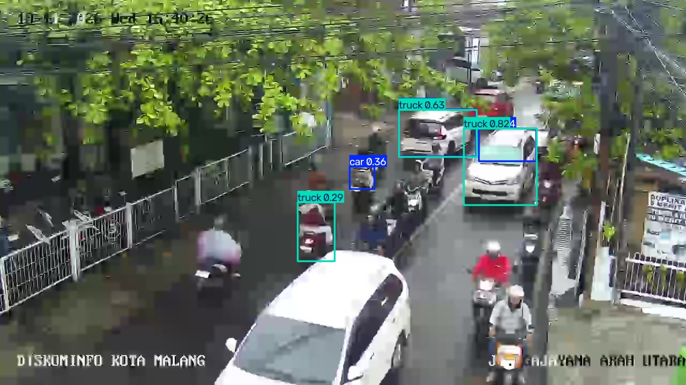 |

## Struktur Proyek

| Berkas / folder | Isi |
|---|---|
| `app.py` | Server FastAPI: polling CCTV, pipeline deteksi, API publik, penyajian dashboard |
| `admin_api.py` | Endpoint publik & admin (lokasi, log, frame, deteksi, ROI, setelan, rute) |
| `vision.py` | Deteksi YOLO, tiling, CLAHE, filter ROI, penggambaran kotak |
| `atcs_routing.py` | V/C ratio, waktu tempuh BPR, pemilihan rute, log keputusan |
| `frame_queue.py` | Antrian frame per kamera (buang frame basi, batasi beban YOLO) |
| `runtime.py` | Override setelan dari dashboard (`runtime_state.json`) + ekspor config |
| `gis_malang.py`, `gis/` | Data jalan OSM Malang, simpang, dan bentuk rute demo |
| `cctvmakota-dashboard/` | Sumber dashboard: `index.html`, `dashboard.html`, `build_single_file.py`, logo |
| `training/` | Pengumpulan frame, pra-label, training, evaluasi, benchmark |
| `dokumentasi/` | Laporan lengkap, panduan demo, grafik model, dan screenshot |
| `config.cctvmakota.yaml` | Konfigurasi aktif: kamera, ROI, ambang, rute, deteksi |
| `requirements.txt` | Dependensi Python |

## Instalasi

### 1. Prasyarat

| Kebutuhan | Keterangan |
|---|---|
| Python **3.10–3.12** | `numpy==1.26.4` belum mendukung Python 3.13 |
| `ffmpeg` | **Wajib** untuk membaca stream HLS |
| RAM ≥ 2 GB | Tanpa GPU tetap jalan; PyTorch cukup besar |
| GPU NVIDIA | Opsional, mempercepat inferensi |

```bash
# Ubuntu / Debian
sudo apt update
sudo apt install -y git curl python3 python3-venv python3-pip ffmpeg

# Windows (winget)
winget install Gyan.FFmpeg
```

Cek instalasi:

```bash
ffmpeg -version | head -1
python --version
```

### 2. Virtual environment & dependensi

```bash
python -m venv .venv

# Windows
.venv\Scripts\Activate.ps1
# Linux / macOS
source .venv/bin/activate

pip install --upgrade pip

# VPS / PC tanpa GPU — pasang PyTorch versi CPU lebih dulu
pip install torch torchvision --index-url https://download.pytorch.org/whl/cpu
pip install -r requirements.txt
```

Untuk server tanpa layar, OpenCV headless disarankan:

```bash
pip uninstall opencv-python -y
pip install opencv-python-headless
```

Jangan memasang `opencv-python` dan `opencv-python-headless` bersamaan. Proyek ini tidak memakai GUI OpenCV — frame diambil lewat `ffmpeg` dan anotasi memakai Pillow.

### 3. Siapkan Supabase (opsional)

Tanpa Supabase, semua fitur tetap jalan kecuali tab **Riwayat**.

1. Buat proyek di [supabase.com](https://supabase.com).
2. Buka **SQL Editor**, lalu jalankan:

```sql
create table if not exists public.greenflow_logs (
  id              bigint generated always as identity primary key,
  created_at      timestamptz not null default now(),
  device_id       text,
  location        text,
  vehicle_count   integer,
  counts_by_class jsonb,
  traffic_status  text
);

create index if not exists greenflow_logs_loc_time_idx
  on public.greenflow_logs (location, created_at desc);

-- Server memakai service_role key (melewati RLS).
alter table public.greenflow_logs enable row level security;
```

3. Ambil **Project URL** dan **service_role key** di *Project Settings → API*.

> `service_role key` hanya boleh ada di server. Jangan pernah memasukkannya ke repo, dashboard, atau kode frontend.

### 4. Konfigurasi

Konfigurasi dibaca dari `config.cctvmakota.yaml` (bisa diganti lewat environment variable `CCTVMAKOTA_CONFIG`).

```yaml
supabase:
  url: https://PROJECT_REF.supabase.co
  service_key: ${SUPABASE_SERVICE_KEY}

admin_token: ${ADMIN_TOKEN}
timezone: Asia/Jakarta
cctv_poll_interval_seconds: 30
cctv_ffmpeg_timeout: 20

detect:
  model: runs/yolo11s_malang_live/weights/best.pt
  imgsz: 960
  enhance: auto
  tiles: 2x3
  conf: 0.25
  iou: 0.65
```

Nilai `${...}` adalah *placeholder*: server membacanya dari environment variable. Isi minimal yang perlu disiapkan:

| Variabel | Fungsi |
|---|---|
| `ADMIN_TOKEN` | Token login panel admin. Tanpa ini, fitur admin dimatikan (HTTP 503) |
| `SUPABASE_SERVICE_KEY` | Kunci Supabase untuk menyimpan riwayat |
| `CCTVMAKOTA_CONFIG` | Lokasi file config alternatif (opsional) |
| `CCTVMAKOTA_OUTPUT` | Folder output (default `Output`) |

### 5. Bobot model

Repo tidak menyertakan `best.pt`. Ada dua pilihan:

**A. Pakai model hasil fine-tune (disarankan).** Letakkan berkas di:

```text
runs/yolo11s_malang_live/weights/best.pt
```

**B. Pakai model Ultralytics bawaan.** Ubah `detect.model` menjadi nama model agar diunduh otomatis saat pertama kali dijalankan:

```yaml
detect:
  model: yolo11s.pt
```

Model bawaan tetap bisa mendeteksi mobil/motor/bus/truk (kelas COCO), tetapi akurasi pada frame CCTV Malang lebih rendah daripada model hasil fine-tune.

### 6. Jalankan server

```bash
python -m uvicorn app:app --host 0.0.0.0 --port 8011
```

Buka <http://127.0.0.1:8011/>.

### 7. Menjalankan sebagai service (systemd)

```ini
# /etc/systemd/system/cctvmakota.service
[Unit]
Description=CCTVMAKOTA
After=network.target

[Service]
User=ubuntu
WorkingDirectory=/home/ubuntu/cctvmakota
Environment="ADMIN_TOKEN=token-rahasia-anda"
Environment="SUPABASE_SERVICE_KEY=service-role-key"
ExecStart=/home/ubuntu/cctvmakota/.venv/bin/python -m uvicorn app:app --host 0.0.0.0 --port 8011
Restart=always

[Install]
WantedBy=multi-user.target
```

```bash
sudo systemctl daemon-reload
sudo systemctl enable --now cctvmakota
sudo systemctl status cctvmakota
```

### 8. GPS di HP butuh HTTPS

Browser hanya mengizinkan GPS pada **HTTPS** atau `localhost`. Jika dashboard dibuka lewat `http://<IP-PC>:8011`, tombol **Coba dengan titik demo** tetap bisa dipakai. Untuk GPS sungguhan, gunakan reverse proxy HTTPS (Nginx/Caddy) atau tunnel sementara seperti `ngrok http 8011`.

## Konfigurasi Deteksi

```yaml
detect:
  model: runs/yolo11s_malang_live/weights/best.pt
  fallback_model: models/yolov8n.pt
  imgsz: 960        # resolusi input; 960 dipilih karena kendaraan CCTV relatif kecil
  conf: 0.25        # ambang keyakinan minimum
  iou: 0.65         # ambang NMS
  enhance: auto     # CLAHE otomatis saat gelap/buram (malam, hujan); off = mati
  tiles: 2x3        # frame penuh + 6 potongan; off = mati (lebih cepat, objek kecil terlewat)
  tile_imgsz: 640
  heavy_min_conf: 0.45
```

Setelan global bisa ditimpa per kamera melalui blok `detect:` di dalam entri `locations`. Contoh: kamera jauh memakai `imgsz` lebih besar, kamera dekat mematikan `tiles` agar lebih ringan.

## Model & Pelatihan

Model produksi: **YOLO11s** hasil fine-tune dari `yolo11s.pt` (COCO), 100 epoch, `imgsz` 960.

### Dataset

Frame diambil langsung dari 5 CCTV Malang (`training/collect_malang_dataset_smart.py`), ditambah frame malam dan hujan (`training/add_condition_frames.py`). Semua frame diberi pra-label dengan YOLO11x (`training/prepare_malang_labels.py`), lalu dikoreksi manual.

| Split | Gambar | car | motorcycle | bus | truck | Total kotak |
|---|---|---|---|---|---|---|
| train | 584 | 2.080 | 880 | 20 | 664 | 3.644 |
| val | 143 | 509 | 176 | 5 | 141 | 831 |

### Hasil validasi

| Metrik | Nilai |
|---|---|
| Precision | 0,591 |
| Recall | 0,465 |
| mAP50 | 0,559 |
| mAP50-95 | 0,442 |
| Kecepatan (GPU, 960 px) | ±12 ms/frame (±55 ms dengan tiling 2×3) |

| Kelas | Precision | Recall | mAP50 | mAP50-95 |
|---|---|---|---|---|
| car | 0,818 | 0,532 | 0,684 | 0,541 |
| motorcycle | 0,765 | 0,568 | 0,714 | 0,462 |
| bus | 0,000 | 0,000 | 0,006 | 0,002 |
| truck | 0,781 | 0,758 | 0,832 | 0,764 |

> Kelas **bus** masih lemah karena hanya ada 20 kotak di data latih. Untuk penggunaan produksi, tambahkan frame yang memuat bus lalu latih ulang. Detail grafik dan pembahasan ada di **[Laporan](dokumentasi/LAPORAN.md)**.

### Melatih ulang

```bash
# 1) Kumpulkan frame dari CCTV (server harus berjalan)
python training/collect_malang_dataset_smart.py

# 2) Tambah frame kondisi khusus: tag, menit, jeda detik
python training/add_condition_frames.py malam 20 30
python training/add_condition_frames.py hujan 15 30

# 3) Pra-label otomatis (default 400 gambar), lalu koreksi manual
python training/prepare_malang_labels.py 600

# 4) Fine-tune: epoch, imgsz, model dasar
python training/train_malang.py 80 960 yolo11s.pt
```

Hasil training tersimpan di `runs/yolo11s_malang_live/`. Setelah selesai, arahkan `detect.model` ke `best.pt` yang baru.

## Referensi API

Dokumentasi interaktif tersedia di `/docs` saat server berjalan.

### Publik

| Endpoint | Fungsi |
|---|---|
| `GET /` | Dashboard CCTVMAKOTA |
| `GET /api/health` | Status server, kamera, dan Supabase |
| `GET /api/public-config` | Konfigurasi publik (lokasi, ambang, status admin) |
| `GET /api/locations` | Semua lokasi CCTV + status kepadatan terakhir |
| `GET /api/frame?location=...` | Frame kamera terbaru (JPEG) |
| `GET /api/logs?location=&limit=` | Riwayat deteksi dari Supabase |
| `GET /api/hourly?location=&range=` | Rata-rata kendaraan per jam |
| `GET /api/detections?location=...` | Hasil deteksi terakhir (kotak, kelas, confidence) |
| `GET /api/detections/image?location=...` | Gambar hasil deteksi (JPG/PNG) |
| `GET /api/roi?location=...` | Poligon ROI yang aktif |
| `GET /api/atcs/scenario` | Status kamera + rekomendasi rute |
| `POST /api/atcs/scenario` | Simulasi skenario rute |
| `GET /api/gis/roads` | Jaringan jalan OSM Kota Malang |
| `GET /api/gis/analysis` | Analisis kecocokan pin CCTV dengan ruas jalan |
| `GET /api/demo/macet?level=0..100&objective=fastest\|shortest` | Simulasi kemacetan A→B + jalur alternatif |
| `GET /api/atcs/decision-log` | Log keputusan rute |

### Admin

Semua endpoint admin memerlukan header `Authorization: Bearer <ADMIN_TOKEN>`.

| Endpoint | Fungsi |
|---|---|
| `POST /api/admin/login` | Verifikasi token admin |
| `GET /api/admin/settings?location=` | Baca setelan lokasi |
| `PUT /api/admin/settings` | Ubah lokasi, ROI, ambang, atau setelan lain |
| `POST /api/admin/export-config` | Simpan perubahan ke `config.cctvmakota.yaml` |
| `GET /api/admin/routes` | Daftar rute dan status koridor |
| `PUT /api/admin/routes` | Ubah rute/koridor |
| `PUT /api/admin/route-list` | Tambah atau ubah daftar ruas jalan |
| `DELETE /api/admin/route-list` | Hapus ruas jalan |

Contoh:

```bash
curl "http://127.0.0.1:8011/api/atcs/scenario"
curl "http://127.0.0.1:8011/api/demo/macet?level=95&objective=fastest"
curl -X POST "http://127.0.0.1:8011/api/admin/login" \
  -H "Authorization: Bearer $ADMIN_TOKEN"
```

## Screenshot

Semua gambar adalah **screenshot satu halaman penuh** (bukan terpotong). Klik gambar untuk melihat ukuran asli.

### Dashboard

| Mobile | Tablet | Windows |
|---|---|---|
|  |  |  |

### Pantauan & Rute

| Mobile | Tablet | Windows |
|---|---|---|
|  | 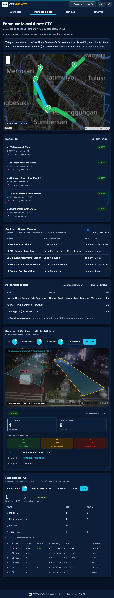 | 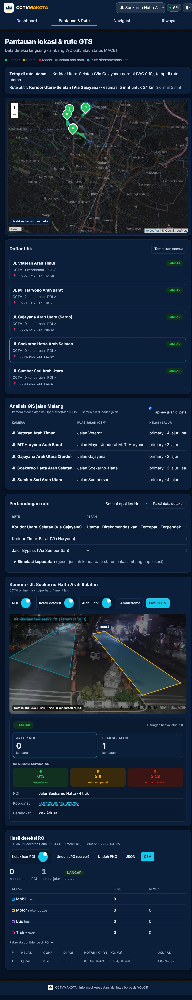 |

### Navigasi — simulasi kemacetan 95%

| Mobile | Tablet | Windows |
|---|---|---|
|  |  |  |

Alur lengkap di HP — izin lokasi → lancar 0% → padat 60% → macet 95%:

| Izin lokasi | Lancar 0% | Padat 60% | Macet 95% |
|---|---|---|---|
| 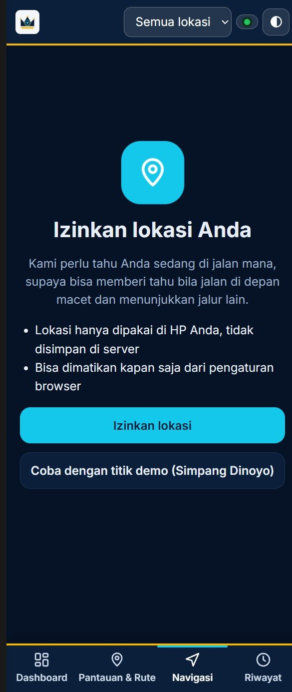 | 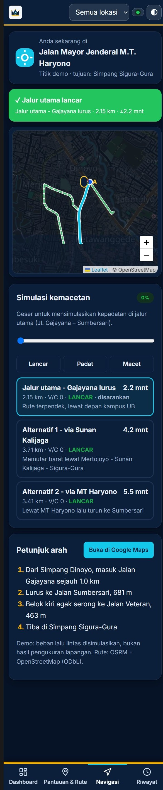 |  |  |

> Pada 95%, jalur utama Gajayana membutuhkan ±7,7 menit, sehingga sistem mengalihkan ke **Alternatif 1 via Sunan Kalijaga** (±4,2 menit, hemat ±3,5 menit).

### Riwayat

| Mobile | Tablet | Windows |
|---|---|---|
| 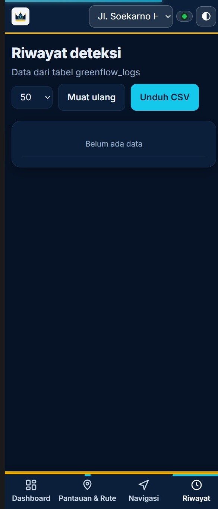 |  | 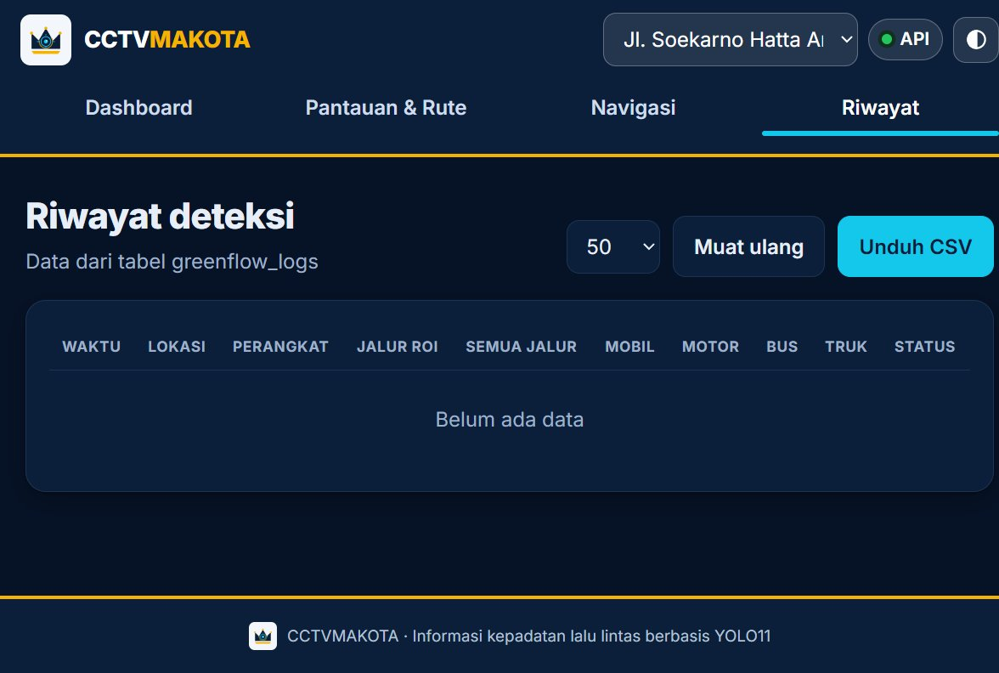 |

### Admin

| Mobile | Tablet | Windows |
|---|---|---|
|  | 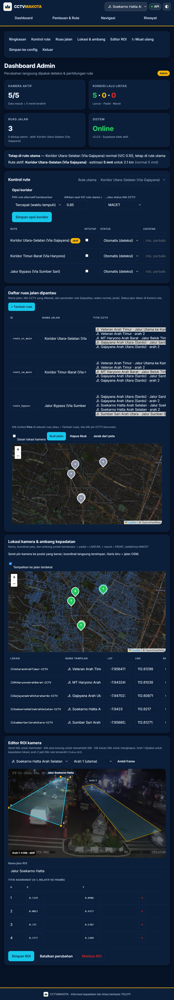 | 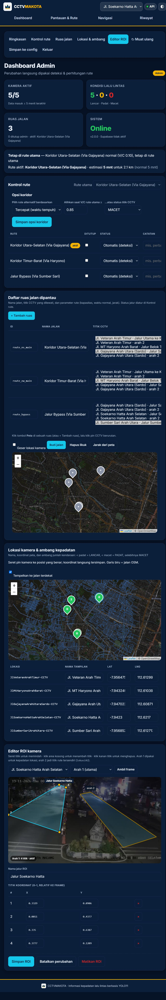 |

Screenshot per fitur dan penjelasan tiap halaman ada di **[fitur_dashboard.md](fitur_dashboard.md)**.

## Pemecahan Masalah

| Gejala | Penyebab & solusi |
|---|---|
| Dashboard kosong / "Memuat data…" terus | Server belum jalan, atau kamera gagal diambil. Cek `GET /api/health` dan log terminal. Pastikan `ffmpeg` ada di `PATH`. |
| `FileNotFoundError` saat memuat model | `best.pt` tidak ada. Letakkan bobot di `runs/yolo11s_malang_live/weights/`, atau set `detect.model: yolo11s.pt` agar diunduh otomatis. |
| Deteksi lambat di CPU | Turunkan `imgsz` (mis. 640) dan set `tiles: off`, atau jalankan di GPU. |
| Tab Riwayat kosong | `SUPABASE_SERVICE_KEY` belum diisi atau tabel `greenflow_logs` belum dibuat. |
| `admin_token belum diisi` (HTTP 503) | Set environment variable `ADMIN_TOKEN`, lalu jalankan ulang server. |
| Pin GPS tidak muncul di HP | GPS browser hanya aktif lewat HTTPS/localhost. Pakai tunnel HTTPS atau tombol **Coba dengan titik demo**. |
| `Address already in use` | Port 8011 dipakai proses lain. Jalankan dengan `--port 8012` atau hentikan proses lama. |
| `ImportError: libGL.so.1` | Pasang `opencv-python-headless` seperti pada langkah instalasi. |
| Config gagal dibaca | Pastikan berkas memakai UTF-8. Server sudah menangani BOM dari editor Windows (`utf-8-sig`). |

## Keamanan & Etika

- **Tidak ada perekaman permanen.** Frame diproses di memori untuk deteksi; yang disimpan ke Supabase hanya jumlah kendaraan, kelas, status, dan waktu.
- **Tidak mengendalikan lampu lalu lintas.** Sistem bersifat *decision support* dan hanya memberi rekomendasi rute.
- **Lokasi pengguna tidak dikirim ke server.** GPS dipakai di browser untuk menentukan posisi di peta.
- **Token admin adalah rahasia.** Simpan di environment variable, jangan di config yang di-commit. Endpoint admin dilindungi perbandingan token yang aman (`hmac.compare_digest`).
- **Service key Supabase hanya untuk server.** Jangan pernah memakai `service_role key` di frontend.
- **Gunakan CCTV publik secara bertanggung jawab.** Hormati ketentuan penyedia stream dan privasi orang di jalan.

## Lisensi & Kredit

Repo ini belum menyertakan berkas `LICENSE`; hubungi pemilik proyek sebelum menggunakan kode untuk keperluan komersial.

- Model deteksi: [Ultralytics YOLO11](https://github.com/ultralytics/ultralytics) — AGPL-3.0.
- Peta dan data jalan: © kontributor [OpenStreetMap](https://www.openstreetmap.org/copyright) — ODbL.
- Stream CCTV: portal CCTV publik Kota Malang / `stream.24hour.id`.
- Pustaka: [FastAPI](https://fastapi.tiangolo.com/), [Leaflet](https://leafletjs.com/), [Chart.js](https://www.chartjs.org/), [hls.js](https://github.com/video-dev/hls.js).

<div align="center">

Dibuat untuk penelitian pemantauan lalu lintas di sekitar **Universitas Brawijaya, Malang**.

</div>
