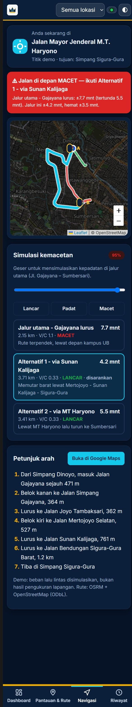
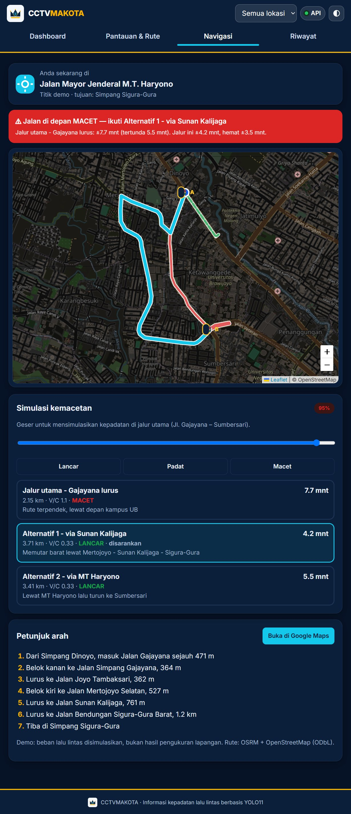
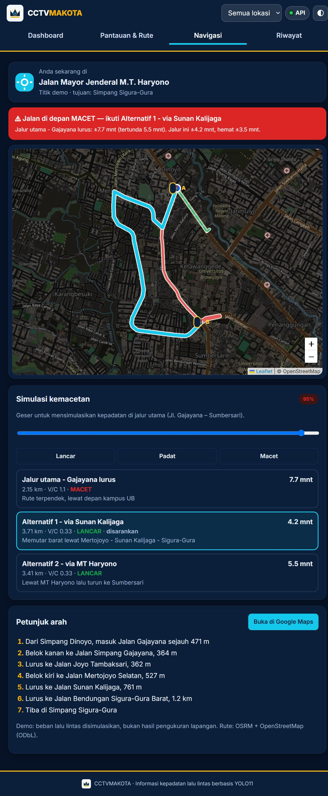
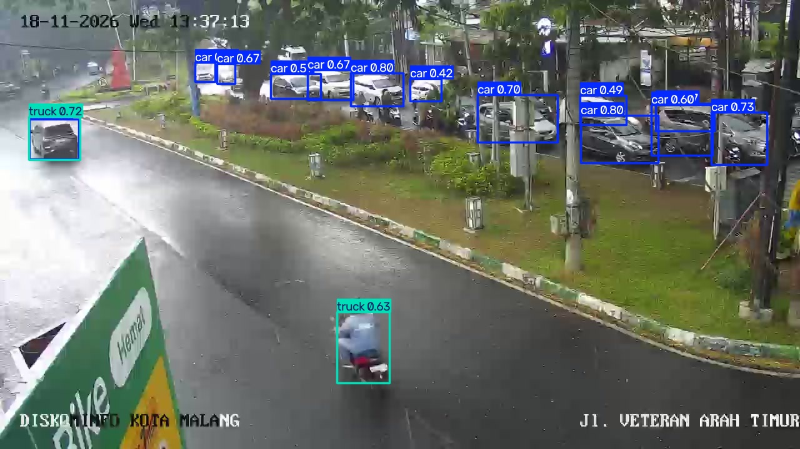
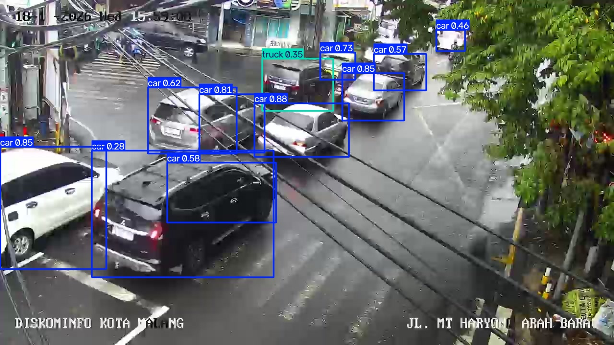

# CCTVMAKOTA — Pemantauan Kepadatan Lalu Lintas Malang + Rute Alternatif

Sistem pemantauan kepadatan lalu lintas berbasis **YOLO11** untuk 5 CCTV ATCS Kota Malang (sekitar Universitas Brawijaya). Server membaca frame CCTV, menghitung kendaraan per jenis (mobil, motor, bus, truk) di jalur yang dipantau (ROI), menentukan status **LANCAR / PADAT / MACET**, lalu memberi **rekomendasi rute alternatif** bila jalur utama macet.

| Mobile | Tablet | Windows |
|---|---|---|
|  |  |  |

> Contoh: jalur utama Gajayana macet 95% (±7,7 mnt), sistem menyarankan Alternatif 1 via Sunan Kalijaga (±4,2 mnt, hemat ±3,5 mnt).

## Fitur utama

- **Deteksi kendaraan** YOLO11s hasil fine-tune CCTV Malang (4 kelas: car, motorcycle, bus, truck), tetap jalan saat pagi, malam, dan hujan.
- **Hitung per jalur (ROI)**: hanya kendaraan di dalam poligon jalur yang dihitung; poligon bisa diedit dari panel admin.
- **Status kepadatan** per kamera berdasarkan ambang padat/macet yang bisa diatur.
- **Rekomendasi rute** (V/C ratio + rumus BPR) dan peta GIS jalan Malang dari OpenStreetMap.
- **Navigasi anti-macet** untuk HP: izin lokasi, lalu "Anda sekarang di", peringatan berwarna, pilihan jalur, dan petunjuk arah.
- **Panel admin**: kontrol rute, ruas jalan, lokasi kamera & ambang, editor ROI.
- Tampilan responsif untuk mobile, tablet, dan desktop.

## Contoh deteksi model

| Soekarno Hatta (42 kendaraan) | Veteran (15) | MT Haryono (11) |
|---|---|---|
|  |  |  |

## Hasil training model

Model produksi: `runs/yolo11s_malang_live/weights/best.pt` (fine-tune dari `yolo11s.pt`, 18 MB).

| Metrik (validasi, 143 gambar) | Nilai |
|---|---|
| Precision | 0,591 |
| Recall | 0,465 |
| mAP50 | 0,559 |
| mAP50-95 | 0,442 |
| Kecepatan (GPU, 960 px) | ±12 ms/frame (±55 ms dengan tiling 2x3) |

Detail per kelas, grafik, dan penjelasan ada di **[Laporan](dokumentasi/LAPORAN.md)**.

## Instalasi & menjalankan

Kebutuhan: Python 3.10+, `ffmpeg` di PATH (untuk membaca stream CCTV), GPU NVIDIA opsional (CPU tetap bisa, tapi lebih lambat).

```bash
git clone <url-repo> cctvmakota
cd cctvmakota
pip install -r requirements.txt
set ADMIN_TOKEN=token-rahasia-anda   # Linux/macOS: export ADMIN_TOKEN=...
python -m uvicorn app:app --host 0.0.0.0 --port 8011
```

- Dashboard: <http://127.0.0.1:8011/>
- Panel admin: <http://127.0.0.1:8011/#admin> (token dari environment variable `ADMIN_TOKEN`, contoh di `.env.example`)
- Dari HP di jaringan yang sama: `http://<IP-komputer>:8011/`. Izin lokasi (GPS) di HP hanya bisa lewat HTTPS; tanpa HTTPS pakai tombol **"Coba dengan titik demo"**.

Riwayat deteksi memakai Supabase (opsional). Isi `SUPABASE_SERVICE_KEY` sebagai environment variable; tanpa itu tab Riwayat menampilkan "Riwayat belum aktif".

## Konfigurasi deteksi (`config.cctvmakota.yaml`)

```yaml
detect:
  model: runs/yolo11s_malang_live/weights/best.pt
  imgsz: 960      # ukuran input frame penuh
  conf: 0.25      # ambang keyakinan minimum
  iou: 0.65       # ambang NMS
  enhance: auto   # CLAHE otomatis saat frame gelap/buram (malam, hujan)
  tiles: 2x3      # frame penuh + 6 potongan agar kendaraan kecil/jauh terdeteksi; off = mati
```

## API singkat

| Endpoint | Fungsi |
|---|---|
| `GET /api/health` | status server |
| `GET /api/atcs/scenario` | status kamera + rekomendasi rute |
| `GET /api/gis/roads`, `GET /api/gis/analysis` | jaringan jalan OSM + kecocokan pin CCTV |
| `GET /api/demo/macet?level=0..100` | simulasi kemacetan A→B + jalur alternatif |
| `GET /api/atcs/decision-log` | log keputusan rute |

## Struktur proyek

| Berkas / folder | Isi |
| --- | --- |
| `app.py` | server FastAPI: polling CCTV, deteksi, API publik |
| `admin_api.py` | endpoint admin (ROI, ambang, koordinat, ruas jalan, simpan config) |
| `vision.py` | deteksi YOLO, tiling, CLAHE, filter ROI, gambar kotak |
| `atcs_routing.py` | V/C ratio, waktu tempuh BPR, pemilihan rute |
| `gis_malang.py`, `gis/` | data jalan OSM Malang |
| `demo_macet.py` | skenario demo kemacetan A→B |
| `runtime.py`, `runtime_state.json` | setelan yang diubah dari dashboard |
| `cctvmakota-dashboard/` | sumber dashboard (`index.html`) + `build_single_file.py` → `dashboard.html` |
| `training/` | pengumpulan frame, pra-label, training, benchmark |
| `runs/yolo11s_malang_live/` | hasil training model produksi |
| `dokumentasi/` | laporan, demo, screenshot fitur |

## Melatih ulang model

```bash
python training/add_condition_frames.py malam 30 25   # tambah frame malam/hujan (server harus jalan)
python training/prepare_malang_labels.py              # pra-label, lalu koreksi manual
python training/train_malang.py 80 960 yolo11s.pt     # fine-tune -> runs/yolo11s_malang_live
```

Setelah itu arahkan `detect.model` di config ke `best.pt` yang baru.

## Dokumentasi

- [Laporan lengkap (penjelasan, cara pakai, model)](dokumentasi/LAPORAN.md)
- [Demo kemacetan A→B + jalur alternatif](dokumentasi/README.md)
- [Fitur dashboard & admin (screenshot)](dokumentasi/fitur_dashboard.md)

## Lisensi data

Peta dan rute © kontributor OpenStreetMap (ODbL), rute via OSRM. Model berbasis Ultralytics YOLO11 (AGPL-3.0).
