# Dokumentasi Demo Kemacetan Lampu Merah A → B + Jalur Alternatif

Dokumen ini menjelaskan demo CCTVMAKOTA: satu jalan dari lampu merah A ke B dibuat macet, lalu sistem mengarahkan pengguna ke jalur alternatif. Tersedia di HP (mobile) dan Windows (desktop) lewat tab **Navigasi** di dashboard.

## 1. Skenario

| Titik | Lokasi | Koordinat |
|---|---|---|
| **Lampu merah A** | Simpang Dinoyo (Jl. Gajayana × Jl. MT Haryono) | -7.94312, 112.61030 |
| **Lampu merah B** | Simpang Sigura-Gura (Jl. Veteran × Jl. Sumbersari) | -7.95669, 112.61278 |

Kedua titik diambil dari simpang jalan utama hasil analisis data jalan OSM (`gis_malang.major_junctions()`, disimpan di `gis/traffic_signals.json`).

| Jalur | Lewat | Jarak | Waktu lancar | Kamera |
|---|---|---|---|---|
| **Utama** | Gajayana → Sumbersari → Veteran | 2,15 km | 2,2 mnt | Gajayana, Sumbersari, Veteran |
| **Alternatif 1** | Simpang Gajayana → Mertojoyo → Sunan Kalijaga → Sigura-Gura | 3,71 km | 4,2 mnt | Gajayana |
| **Alternatif 2** | MT Haryono → Sumbersari | 3,41 km | 5,5 mnt | MT Haryono, Sumbersari |

Bentuk jalurnya mengikuti jalan sungguhan, dihitung dengan OSRM di atas data OpenStreetMap, lalu disimpan ke `gis/demo_routes.json`. Setelah tersimpan, demo bisa berjalan tanpa internet, kecuali gambar peta dasarnya.

## 2. Hasil demo

| Kemacetan jalur utama | V/C utama | Status | Waktu utama | Keputusan |
|---|---|---|---|---|
| 0% | 0,00 | LANCAR | 2,2 mnt | Tetap di jalur utama |
| 60% | 0,68 | PADAT | 2,3 mnt | Tetap di jalur utama (masih tercepat) |
| 95% | 1,10 | **MACET** | **7,7 mnt** | **Dialihkan ke Alternatif 1 (4,2 mnt, hemat ±3,5 mnt)** |

## 3. Cara menghitung

1. **Beban jalur.** Slider 0–100% menentukan beban jalur utama: `beban = kapasitas × level × 1,15`. Jalur alternatif ikut menerima 35% limpahan kendaraan.
2. **Kapasitas.** Jumlah lajur × 1.800 smp/jam per lajur (MKJI disederhanakan).
3. **V/C** = beban ÷ kapasitas. Status ditentukan dari nilai V/C:
   - di bawah 0,6: LANCAR
   - 0,6 sampai di bawah 0,85: PADAT
   - 0,85 ke atas: MACET
4. **Waktu tempuh.** Dihitung dengan rumus BPR, `t = t0 × (1 + 0,15 × (V/C)^4)`, ditambah tundaan antrean di lampu merah sebesar `(V/C − 0,85) × 20 mnt` bila V/C melewati 0,85.
5. **Pemilihan jalur.** Memakai `atcs_routing.compute_recommendation`, logika yang sama dengan halaman Pantauan & Rute. Pengguna dialihkan hanya bila jalur utama MACET atau V/C ≥ 0,85, dan sistem memilih jalur alternatif yang tercepat.

## 4. Alur di HP (UX)

1. **Loading.** Muncul logo, progress bar, dan keterangan tahapan ("Mengambil jaringan jalan Malang…", lalu "Menghitung kondisi lalu lintas…").
2. **Izin lokasi.**
   - Layar menjelaskan kenapa lokasi dibutuhkan dan bahwa lokasi tidak disimpan di server.
   - Ada dua tombol besar: **Izinkan lokasi** dan **Coba dengan titik demo**.
   - Kalau izin ditolak, muncul pesan yang jelas dan pengguna tetap bisa memakai titik demo.
3. **"Anda sekarang di Jl. …".** Posisi GPS dicocokkan ke ruas jalan OSM terdekat. Kalau pengguna berada lebih dari 3 km dari area demo, otomatis dipakai titik A.
4. **Peringatan berwarna** di atas peta. Di HP, peringatan ini tetap terlihat saat halaman digulir.
   - hijau: lancar
   - kuning: padat
   - merah: **"Jalan di depan MACET — ikuti Alternatif 1"**, beserta keterangan berapa menit yang dihemat
5. **Peta.**
   - Jalur yang disarankan: garis biru tebal.
   - Jalur lain: diwarnai sesuai statusnya; jalur alternatif digambar putus-putus.
   - Lampu merah A dan B ditandai 🚦.
   - Pengguna bisa mengetuk garis atau kartu jalur untuk memilih jalur sendiri.
6. **Petunjuk arah** dalam bahasa Indonesia, langkah demi langkah, ditambah tombol **Buka di Google Maps** yang langsung membuka rute lengkap dengan titik lewatnya.
7. Di HP, menu ada di bar bawah, termasuk tab **Navigasi**.

## 5. Screenshot

Semua screenshot berupa **halaman penuh (screenshot panjang)**, jadi tidak ada bagian yang terpotong. Klik gambar untuk melihat ukuran asli.

### Mobile (lebar 390 px)
| Izin lokasi | Lancar 0% | Padat 60% | Macet 95% |
|---|---|---|---|
| 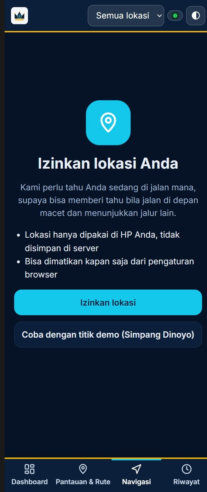 | 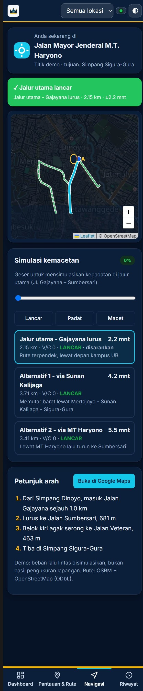 | 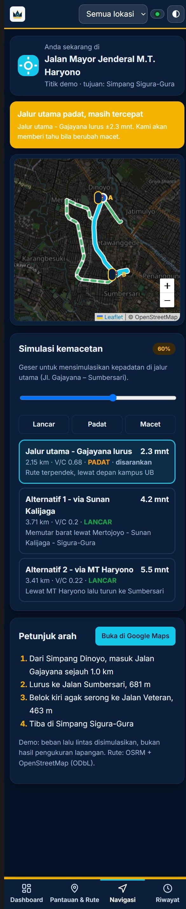 | 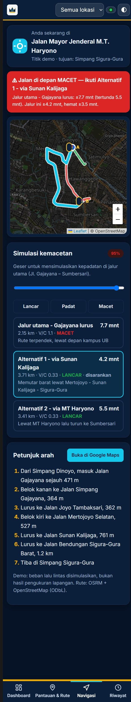 |

### Tablet (lebar 820 px)
| Izin lokasi | Lancar 0% | Padat 60% | Macet 95% |
|---|---|---|---|
| 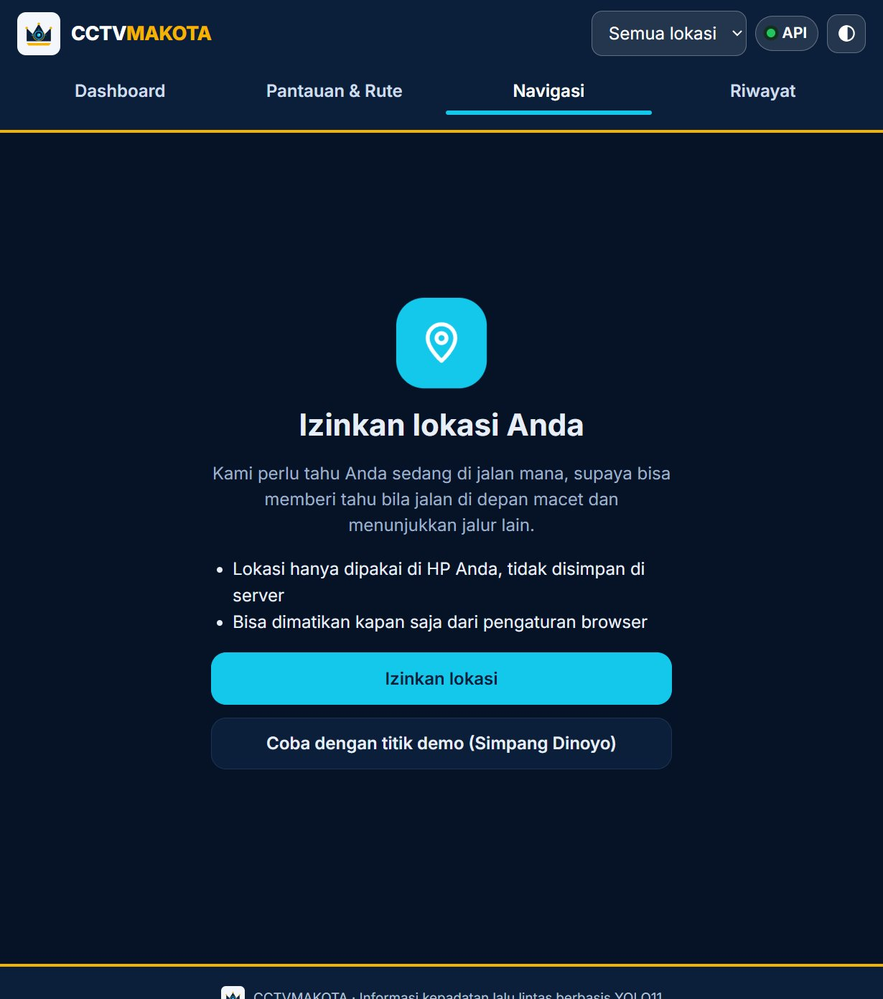 | 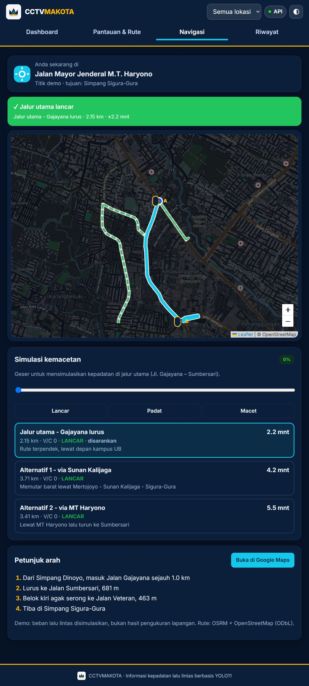 | 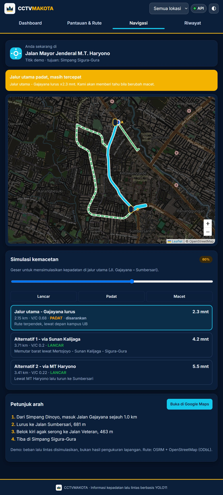 | 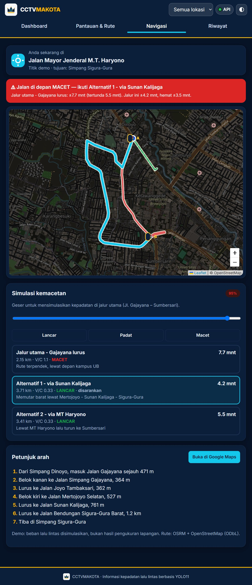 |

### Windows (desktop)
| Izin lokasi | Lancar 0% | Padat 60% | Macet 95% |
|---|---|---|---|
| 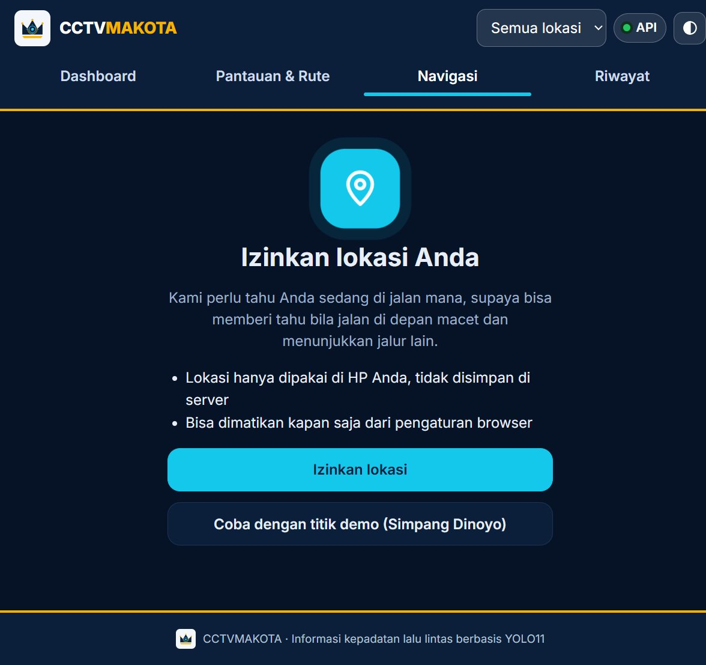 | 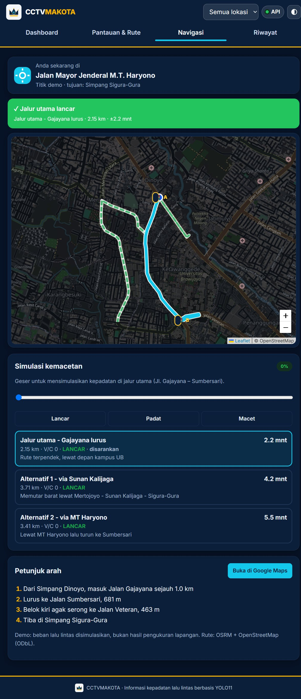 | 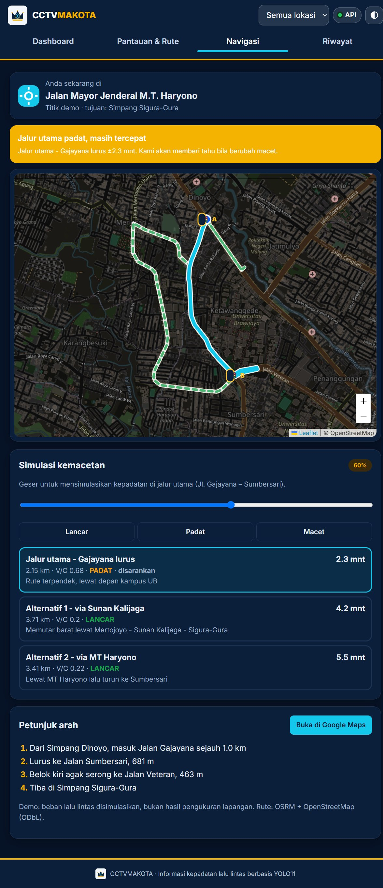 | 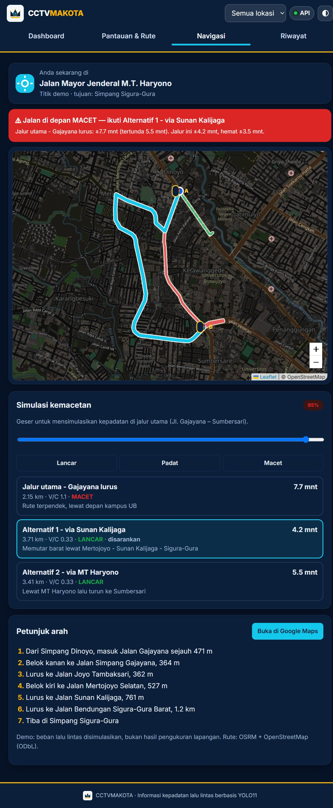 |

## 6. Cara menjalankan

```powershell
python demo_macet.py --fetch      # (sekali) ambil bentuk jalur dari OSRM -> gis/demo_routes.json
python demo_macet.py              # cetak hasil demo 0% / 60% / 95% di terminal
python -m uvicorn app:app --host 0.0.0.0 --port 8011
```

- **Windows:** buka `http://127.0.0.1:8011/#navigasi`.
- **HP:** sambungkan ke Wi-Fi yang sama, lalu buka `http://<IP-PC>:8011/#navigasi`.
  - GPS di browser HP hanya berjalan lewat **HTTPS** atau localhost. Lewat IP biasa (http), pakai tombol "Coba dengan titik demo", atau buka lewat tunnel HTTPS (mis. `ngrok http 8011`).

## 7. API

`GET /api/demo/macet?level=0..100&objective=fastest|shortest`

Respons berisi:

| Field | Isi |
|---|---|
| `a`, `b` | Titik lampu merah A dan B |
| `recommended_route_id` | Jalur yang disarankan |
| `reroute`, `reroute_reason` | Apakah pengguna dialihkan, dan alasannya |
| `instructions[]` | Petunjuk arah |
| `routes[]` | Per jalur: `name`, `role`, `distance_km`, `est_traveltime_minutes`, `delay_minutes`, `vc_ratio`, `traffic_status`, `path` [[lat,lng]…], `steps` |
| `caveat` | Catatan bahwa data demo adalah simulasi |

## 8. File terkait

| File | Fungsi |
|---|---|
| `demo_macet.py` | Titik A/B, daftar jalur, ambil data OSRM (dengan percobaan ulang + server cadangan), skenario, petunjuk arah |
| `gis/demo_routes.json` | Bentuk jalur + langkah belok (cache) |
| `gis_malang.py`, `gis/malang_roads.geojson`, `gis/traffic_signals.json` | Data jalan OSM + titik simpang |
| `app.py` | Endpoint `/api/demo/macet` |
| `cctvmakota-dashboard/index.html` → `dashboard.html` | Tab Navigasi (`Views.navigasi`, `Nav*`) |

## 9. Batasan

- Beban lalu lintas di demo ini **disimulasikan** lewat slider, bukan diambil dari kamera.
- Titik A/B adalah simpang jalan utama menurut data OSM. Data lampu merah resmi gagal diunduh karena server Overpass timeout.
- Angka tundaan antrean (20 mnt per satuan V/C di atas 0,85) adalah asumsi demo dan belum dikalibrasi dengan data lapangan.

## Fitur dashboard & admin
Screenshot semua fitur (Windows + mobile): [fitur_dashboard.md](fitur_dashboard.md)


## Contoh deteksi model (frame terpadat per kamera)

| Soekarno Hatta (42) | Veteran (15) | MT Haryono (11) |
|---|---|---|
| 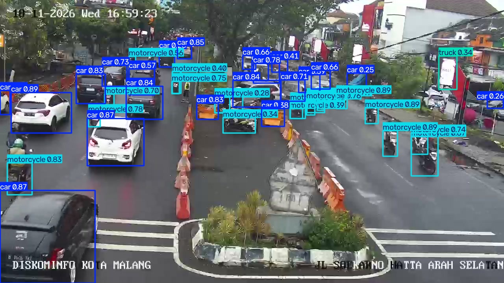 | 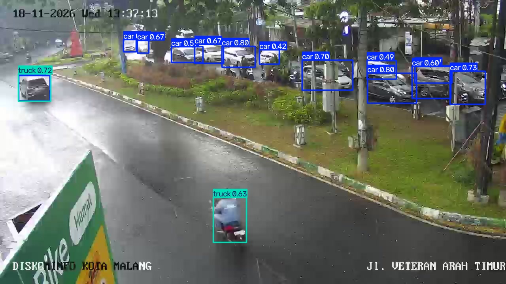 | 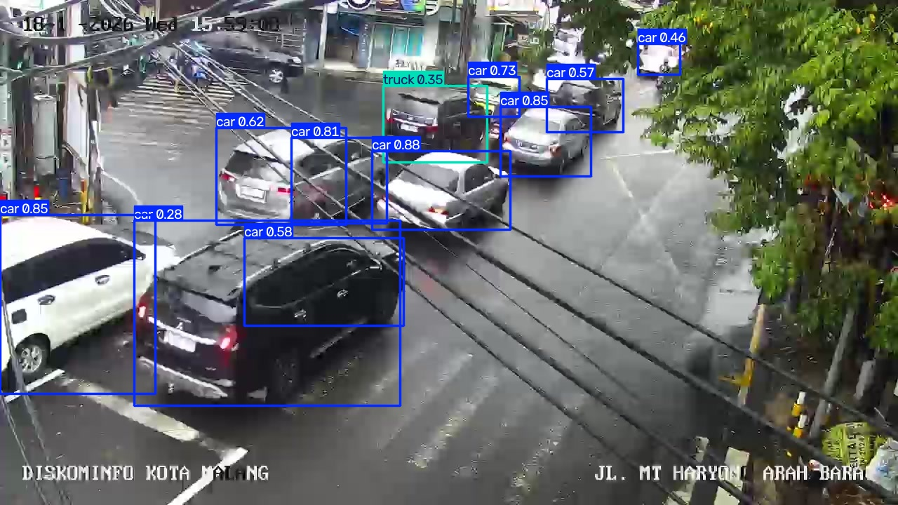 |

| Sumber Sari (11) | Gajayana/Sardo (6) |
|---|---|
| 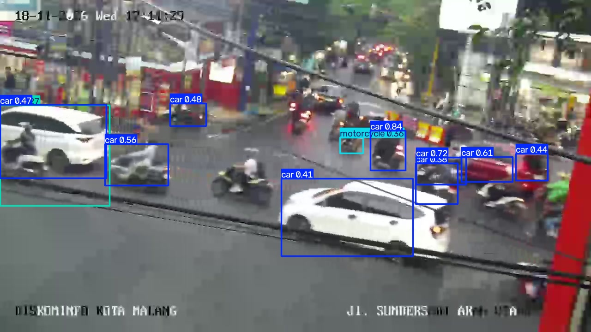 | 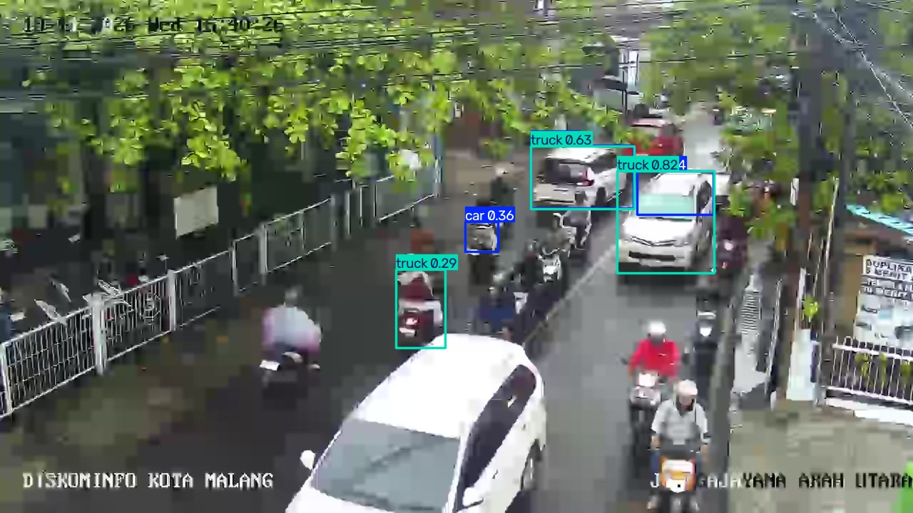 |
